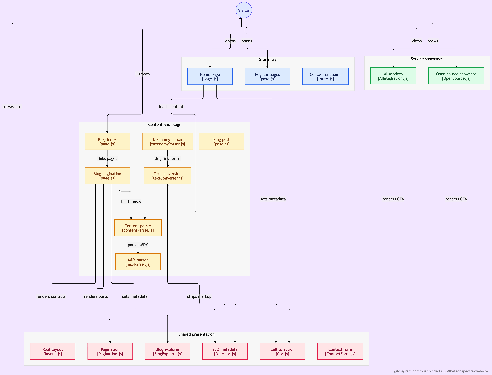

<h1 align=center>Thetechspectra Website </h1> 
<p align=center>Thetechspectra web development business template built in Nextjs. Perfect for Creative Agency, Marketing Agency, Design Studios, Digital Marketing Agencies, and other business service websites.</p>
<h2 align="center"> <a target="_blank" href="https://bigspring-light-nextjs.vercel.app/" rel="nofollow">👀Demo</a> | <a  target="_blank" href="https://pagespeed.web.dev/report?url=https%3A%2F%2Fbigspring-light-nextjs.vercel.app%2F&form_factor=desktop">Page Speed (100%)🚀</a>
</h2>


<p align=center>
  <a href="https://github.com/vercel/next.js/releases/tag/v13.0.6" alt="Contributors">
    
  </a>

  <a href="https://github.com/themefisher/bigspring-light-nextjs/blob/main/LICENSE">
    </a>

  

  <a href="https://github.com/themefisher/bigspring-light-nextjs/graphs/contributors">
    </a>
</p>



## 🔑Key Features

- 📄 9+ Pre-Designed Pages
- ✨ Simple and Minimal
- 📱 Fully Responsive
- 🚀 Google Page Speed score 100! (Desktop)
- 📊 Google Analytics support
- 🗂️ Caching enabled
- ✉️ Supports Contact Form
- 🌍 SEO Friendly

## 📄 9+ Pre-Designed Pages

- 🏠 Home Page
- 📚 Blog Page
- 📝 Blog Single Page
- 📞 Contact Page
- 📄 Features Page
- ❓ FAQ Page
- 🤖 AI Integration Services
- 🌱 Open Source Projects
- 🗂️ Taskautomation Project Preview
- 🔒 Privacy Policy Page
- 🔒 Terms and Condition Page

<!-- installation -->
## ⚙️Installation

After downloading the template, you have some prerequisites to install. Then you can run it on your localhost. You can view the package.json file to see which scripts are included.

### 🔧Install prerequisites (once for a machine)

* **Node Installation:** [Install node js](https://nodejs.org/en/download/) [Recommended LTS version]

### 🖥️Local setup

After successfully installing those dependencies, open this template with any IDE [[VS Code](https://code.visualstudio.com/) recommended], and then open the internal terminal of IDM [vs code shortcut <code>ctrl/cmd+\`</code>]

* Install dependencies

```
npm install
```

* Run locally

```
npm run dev
```

After that, it will open up a preview of the template in your default browser, watch for changes to source files, and live-reload the browser when changes are saved.

## 🔨Production Build

After finishing all the customization, you can create a production build by running this command.

```
npm run build
```

<!-- reporting issue -->
## 🐞Reporting Issues

We use GitHub Issues as the official bug tracker for this Template. Please Search [existing issues](https://github.com/themefisher/bigspring-light-nextjs/issues). It’s possible someone has already reported the same problem.
If your problem or idea has not been addressed yet, feel free to [open a new issue](https://github.com/themefisher/bigspring-light-nextjs/issues).

